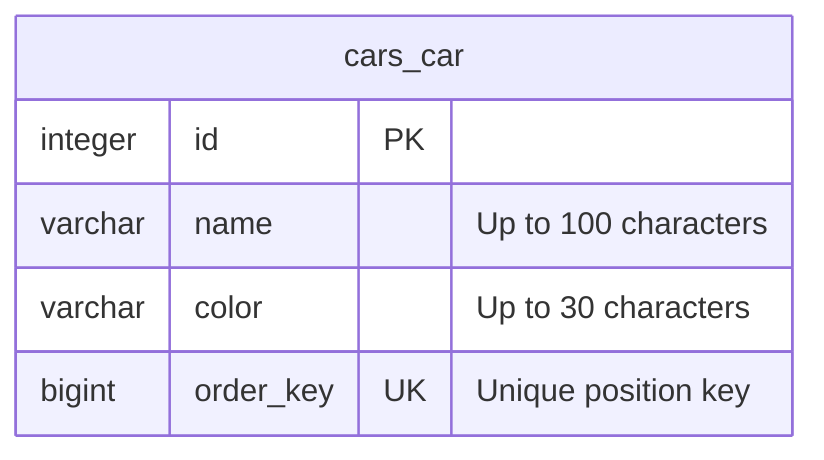

# Car Ledger

Car Ledger is a Django and SQLite application for managing an ordered inventory of 100,000 cars. You can add, edit, delete, filter, and reorder cars from the browser.

## Run locally

Open PowerShell in the repository folder. With Python 3.14 installed, run:

```powershell
python -m venv .venv
.\.venv\Scripts\python.exe -m pip install -r requirements.txt
.\.venv\Scripts\python.exe manage.py migrate
.\.venv\Scripts\python.exe manage.py runserver
```

Open [Car Ledger](http://127.0.0.1:8000/). The included `db.sqlite3` contains sample inventory data. To fill a fresh database to 100,000 cars, run:

```powershell
.\.venv\Scripts\python.exe manage.py seed_cars
```

The command preserves existing cars. Use `--total 60` to populate a smaller inventory for local testing.

## Use the inventory

- **Add car** appends a car to the list. **Edit** changes its name or color and preserves its position.
- **Filter by color** accepts a full color name. The filter keeps the matching cars in their original relative order. Each page shows up to 25 cars.
- **Move** takes the ID of the car that should follow the selected car. Enter the first car's ID to move to the front, or leave the field blank to move to the end. Moves apply to the full inventory, including when a filter is active.
- **Delete** opens a confirmation page before removing the car.

## Ordering and performance

Cars have unique integer order keys. New cars are spaced 1,000,000 keys apart. A typical move finds the destination and its predecessor, then writes a key between them. It updates one car row. Moving a car before itself or leaving it in its current position updates zero rows.

When there is no integer left between neighboring keys, the application reassigns spaced keys to the full list inside the same transaction, then finishes the move. This takes more work but preserves the existing relative order during reassignment. SQLite uses immediate transactions for these writes so concurrent writers take turns before reading the order keys.

The unique order-key index supports ordered reads. The `(color, order_key)` index supports exact color filters in list order. Django uses offset pagination, so later pages can cost more to retrieve than early pages even though each response displays only 25 rows.

## Verify the app

```powershell
.\.venv\Scripts\python.exe manage.py check
.\.venv\Scripts\python.exe manage.py test
```

The tests cover CRUD, validation, missing records, color filtering across pages, moves, and exhausted gaps. Django runs them in a separate test database.

## Database schema

The inventory uses one application table, `cars_car`. Each row represents one car. There are no foreign keys or relationships between application entities.



| Index or constraint | Purpose |
| --- | --- |
| Primary key on `id` | Identifies a car even when its name, color, or position changes. |
| Unique index on `order_key` | Enforces one key per car and supports reading the full inventory in order. |
| `car_color_order_idx` on `(color, order_key)` | Supports exact color filtering with results already in inventory order. |

### Normalization

- **1NF.** Each field contains one value. A car has one name, one color, and one ordering key. The table has no repeating columns or lists inside a field.
- **2NF.** Both candidate keys, `id` and `order_key`, consist of one column. A non-key field cannot depend on only part of either key.
- **3NF.** The non-key attributes `name` and `color` describe the car and do not determine each other. There are no attributes such as a color description or manufacturer address that depend on a non-key attribute.

The functional dependencies include `id → name, color, order_key` and `order_key → id, name, color`. The order key uniquely identifies a row at a given time, while `id` remains stable when a car moves.

Color is stored directly because the app uses it as a single text value. The add and edit form trims whitespace and lowercases the value so `Blue` and `blue` are stored consistently. Repeating the word `blue` across cars is expected because each row records its own color. A separate `Color` table would make sense if the app needed a controlled palette with shared attributes such as display names or paint codes. It would introduce a one-to-many relationship from color to cars.